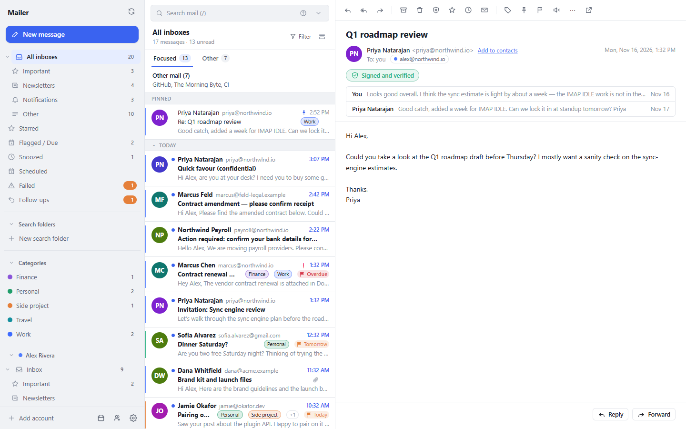

# Mailer

A fast desktop email client. All your accounts in one inbox, with your mail kept on your own computer.

**[Download the latest release](https://github.com/Lojocats/Mailer-releases/releases/latest)** (Windows: file ending in `-setup.exe`; Mac: `.dmg`, `aarch64` for Apple Silicon or `x64` for Intel; Android: `.apk`) · **[Website](https://lojocats.github.io/Mailer-releases/)**

This repository hosts the installers, the auto-update files and the website of Mailer. The source code is private.

## Features

- **One inbox for all your accounts**: IMAP with a password or app password, or "Sign in with Google" for Gmail.
- **Sorted for you**: smart categories, search folders, rules and quick steps.
- **On your schedule**: snooze, send later and undo send.
- **Your contacts, together**: all your contacts in one place, synced with your provider's address book where it offers one.
- **Safer by default**: remote images blocked by default, warnings about suspicious mail and risky attachments.
- **English and French**, with automatic updates.
- **Make it yours**: seven themes, an accent colour, a gradient or your own picture as background, and a message list showing just what you want.

## Platforms

| Platform | Status |
| --- | --- |
| Windows | Available |
| macOS (Apple Silicon and Intel) | Available. Not notarised: the first time, right-click Mailer in Applications and choose Open |
| Android | Available, for Android 7 or later on a 64-bit phone. The first time, allow installing apps from your browser; later updates install from inside Mailer |

## Help and privacy

- [Help](https://lojocats.github.io/Mailer-releases/help.html): connect Infomaniak, Google, iCloud, Fastmail and other providers, including calendars and contacts, and fix common problems.
- [Privacy policy](https://lojocats.github.io/Mailer-releases/privacy.html): no Mailer server, no account, no analytics. Passwords stay in the Windows Credential Manager or the macOS Keychain.
- Questions or problems: [open an issue](https://github.com/Lojocats/Mailer-releases/issues).

## Licence

Mailer is free to use, but it is not open source: you may not redistribute, modify or reverse engineer it. See [LICENSE.txt](LICENSE.txt). The open-source components it includes keep their own licences: see [THIRD-PARTY-NOTICES.txt](docs/THIRD-PARTY-NOTICES.txt).

---

## Français

Un client de messagerie rapide pour votre ordinateur. Tous vos comptes dans une seule boîte de réception, et votre courrier reste sur votre ordinateur.

**[Télécharger la dernière version](https://github.com/Lojocats/Mailer-releases/releases/latest)** (Windows&#8239;: fichier se terminant par `-setup.exe`&#8239;; Mac&#8239;: `.dmg`, `aarch64` pour Apple Silicon ou `x64` pour Intel&#8239;; Android&#8239;: `.apk`) · **[Site web](https://lojocats.github.io/Mailer-releases/)**

Ce dépôt héberge les installateurs, les fichiers de mise à jour automatique et le site de Mailer. Le code source est privé.

### Fonctionnalités

- **Une seule boîte pour tous vos comptes**&#8239;: IMAP avec mot de passe ou mot de passe d’application, ou «&#8239;Se connecter avec Google&#8239;» pour Gmail.
- **Trié pour vous**&#8239;: catégories intelligentes, dossiers de recherche, règles et actions rapides.
- **À votre rythme**&#8239;: reporter, envoi différé et annulation de l’envoi.
- **Vos contacts réunis**&#8239;: vos contacts au même endroit, synchronisés avec le carnet d’adresses de votre fournisseur quand il en propose un.
- **Sûr par défaut**&#8239;: images distantes bloquées par défaut, alertes sur le courrier suspect et les pièces jointes à risque.
- **Anglais et français**, avec mises à jour automatiques.
- **À votre image**&#8239;: sept thèmes, une couleur d’accentuation, un dégradé ou votre propre image en arrière-plan, et une liste des messages qui n’affiche que ce que vous voulez.

### Systèmes

| Système | État |
| --- | --- |
| Windows | Disponible |
| macOS (Apple Silicon et Intel) | Disponible. Non notarié&#8239;: la première fois, clic droit sur Mailer dans Applications, puis Ouvrir |
| Android | Disponible, pour Android 7 ou plus sur un téléphone 64 bits. La première fois, autorisez l’installation d’applications depuis votre navigateur&#8239;; les mises à jour suivantes s’installent depuis Mailer |

### Aide et confidentialité

- [Aide](https://lojocats.github.io/Mailer-releases/help.html)&#8239;: connecter Infomaniak, Google, iCloud, Fastmail et d’autres fournisseurs, calendriers et contacts compris, et résoudre les problèmes courants.
- [Règles de confidentialité](https://lojocats.github.io/Mailer-releases/privacy.html#fr)&#8239;: pas de serveur Mailer, pas de compte, pas de statistiques. Les mots de passe restent dans le Gestionnaire d’identification de Windows ou le trousseau de macOS.
- Questions ou problèmes&#8239;: [ouvrez un ticket](https://github.com/Lojocats/Mailer-releases/issues).

### Licence

Mailer est gratuit, mais ce n’est pas un logiciel libre&#8239;: vous ne pouvez pas le redistribuer, le modifier ni en faire l’ingénierie inverse. Voir [LICENSE.txt](LICENSE.txt). Les composants libres qu’il contient gardent leurs propres licences&#8239;: voir [THIRD-PARTY-NOTICES.txt](docs/THIRD-PARTY-NOTICES.txt).
